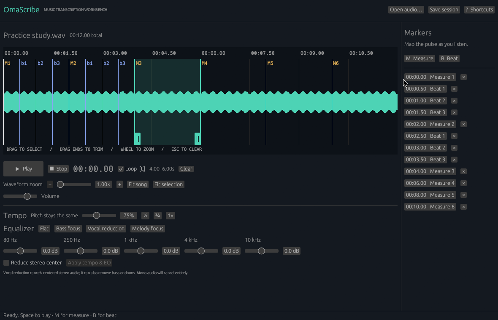

# OmaScribe

A Rust desktop app for transcribing music by ear. Open an audio file, mark
its measures and beats while listening, and repeat difficult passages at a
slower tempo without changing pitch.

## Run

Requires Rust, FFmpeg (including ffprobe), an audio output device, and a
Wayland or X11 desktop. On Arch/Omarchy, build dependencies include
`base-devel`, `pkgconf`, `alsa-lib`, `libxkbcommon`, and `wayland`. File dialogs
use xdg-desktop-portal and the desktop's portal backend.

```sh
./bin/build
./target/release/omascribe
# Or open a file directly:
./target/release/omascribe '/path/to/song.mp3'
```

`./bin/install` builds and installs the binary in `~/.local/bin`, plus its
launcher entry and icon in `~/.local/share`. Ensure `~/.local/bin` is on PATH.
For an Arch package, run `makepkg -p packaging/PKGBUILD` from this directory,
then install the resulting package with `pacman -U`.

## Listen and transcribe

- Open audio with the button, Ctrl+O, a file argument, or drag and drop.
  WAV, MP3, Ogg, FLAC, AAC/M4A, Opus, AIFF, and other FFmpeg audio formats work.
- Press Space to play or pause. Press M at each measure boundary, or B at
  individual beats. Drag a marker line or its label to adjust its timing.
  Where a line overlaps a selection boundary, drag the marker label to move
  the marker or the bottom grip to trim the selection. Ctrl+Z undoes a move.
- Click a marker in the list to jump to it. Shift-click a second marker to
  select the passage between them in either order. Dragging either selected
  marker updates the passage. Use × to delete a marker.
- Click the waveform to seek. Drag in either direction to select a passage
  and enable looping. Press Play to hear it repeatedly. Loop without a
  selection repeats the whole song. Esc or right-click clears the selection.
- Zoom in or out with the **+ / −** buttons or the 1×–128× zoom slider.
  Scroll the mouse wheel over the waveform to zoom around the pointer.
  **Fit song** shows the entire recording; **Fit selection** frames the loop.
  When zoomed in, use **Shift+mouse wheel**, a horizontal trackpad gesture,
  or the wide **Scroll waveform** slider and its left/right arrow buttons
  to move through the song. Scrolling stops at the beginning and end and
  preserves the zoom level, playback position, and loop selection.
- Drag either highlighted end of a selection to adjust its start or end.
  The grips at the bottom of the selection boundaries and the boundary
  lines themselves are draggable. Endpoints cannot cross or leave the song;
  the minimum selection length is 30 ms (or the whole file if shorter).
  Loop boundaries update during playback as you drag.
- Set Tempo from 25% to 150%, then press **Apply tempo & EQ**. Audio pauses
  while a background worker prepares the change, then resumes at the same
  original-song position if it was playing. The active tempo changes only
  after processing succeeds. Markers always use original-song seconds.
- Toggle **Bypass tempo & EQ** to hear the song at normal speed with flat EQ
  and stereo center reduction off. Toggle it again to hear the applied settings
  at the same song position. This comparison is temporary. Sessions save the
  applied settings.
- Adjust five EQ bands (80 Hz, 250 Hz, 1 kHz, 4 kHz, 10 kHz), or choose Flat,
  Bass focus, Melody focus, or Vocal reduction, and apply. Output limiting
  and a volume control help avoid clipping.
- Save a `.omascribe` session to keep the audio reference, markers, loop,
  and applied effects. Session writes are atomic. Audio files are never
  modified or copied into sessions. Reopen sessions through Open audio;
  keep the referenced audio at its original path.

Vocal reduction uses stereo center cancellation, not stem separation. It
reduces centered vocals but may also remove centered bass, kick, or other
instruments. Reverberant or off-center vocals can remain; mono audio cancels
entirely. Disable **Reduce stereo center** or choose Flat to restore it.

## Keyboard

| Key | Action |
| --- | --- |
| Space | Play / pause |
| M | Insert measure marker |
| B | Insert beat marker |
| L | Toggle looping |
| Esc | Clear waveform selection |
| Left / Right | Seek one second |
| Shift+Left / Right | Seek five seconds |
| Home | Return to the beginning |
| Ctrl+O | Open audio or session |
| Ctrl+S | Save session |
| Ctrl+Shift+S | Save session as |
| Ctrl+Z / Ctrl+Shift+Z | Undo / redo marker edits |
| ? | Show shortcuts |
| Q | Quit, with a prompt for unsaved work |

Shortcuts are suspended while editing a text or numeric field. On macOS,
the platform command modifier replaces Ctrl.

## Headless inspection

```sh
omascribe check song.mp3 --json
omascribe check transcription.omascribe --json
omascribe skill install
```

`check` validates session structure and probes audio without a GUI or audio
device. It prints a JSON report on stdout and exits 0; errors go to stderr
and exit 1. `skill install` installs the bundled agent skill under
`$CODEX_HOME/skills/omascribe` (or `~/.codex/skills/omascribe`) without replacing
an existing skill.

## Implementation and limits

The interface uses egui/eframe; CPAL drives the system audio output. FFmpeg
handles decoding, chained `atempo` filters for pitch-preserving tempo, EQ,
stereo cancellation, and limiting. See the [FFmpeg filter documentation](https://ffmpeg.org/ffmpeg-filters.html).

Audio is decoded to stereo float samples at the output device's sample rate.
Each decode is capped at 512 MiB to bound memory use; slower playback needs
more samples. Long recordings may need to be split externally before
opening. Applying effects reprocesses the whole file and may take time.
Playback buffers are held in memory; total peak memory can exceed the
per-decode cap. No automatic note recognition, score engraving, processed
audio export, or AI vocal separation is included. The interface is currently
English. The desktop accent is read live from Omarchy when available.

## Development

```sh
./bin/test
```

Tests exercise original-song loop timing, session persistence/validation,
mouse selection in both directions, trimming both ends (including zoomed
views and file edges), endpoint limits, mouse-wheel zoom, horizontal and Shift+wheel scrolling, marker shortcuts/undo, pitch preservation
at five tempos, and stereo center cancellation. FFmpeg is required for the
audio tests. `bin/test` also checks formatting and runs Clippy with warnings
as errors. The application has been launched and visually checked on
Omarchy/Wayland with generated practice audio.

For the workspace-switch responsiveness regression, build the release binary
and run `./bin/test-workspace` from Hyprland. This optional integration test
opens its own temporary window, moves it to an inactive workspace for 12
seconds without switching your desktop, checks that it continues answering
compositor pings, restores the window, and closes only that test instance.
It requires Python 3 and `hyprctl`; an optional binary argument lets it test
an earlier build.

OpenGL buffer swaps use nonblocking presentation (`vsync: false`). Blocking
vsync can stall the UI thread on a hidden Wayland workspace, preventing it
from answering compositor pings until the window becomes visible again;
[glutin documents this behavior](https://docs.rs/glutin/0.32.3/glutin/surface/enum.SwapInterval.html).
OmaScribe already paces redraws at 30 ms through egui, so disabling the
blocking graphics wait keeps the event loop responsive without a busy loop.

Native open/save dialogs and session writes run on a background worker so the
Wayland event loop keeps answering compositor pings while a dialog is open.
Save-before-close continues only after a successful write; cancelling or a
write failure keeps the session open. Save remembers the last chosen path.
